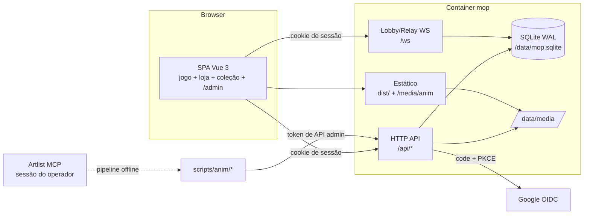

# 00 — Arquitetura, dados e decisões

> Parte do SDD de contas, economia, animações e administração. Índice em [README.md](README.md).

## 1. Estado atual (as-is, 2026-10-31)

| Área | Hoje | Onde |
|---|---|---|
| Front-end | SPA Vue 3 + Vite + Tailwind, rotas em hash (`/#/...`), GSAP para animar mesa e cartas | `src/`, `src/router.js`, `src/views/GameView.vue` |
| Regras | Engine JS pura, roda no navegador (prática contra IA e host online) | `src/engine/engine.js`, `src/engine/ai.js` |
| Online | Servidor Node `ws` faz lobby + **relay opaco**. O seat 0 (host) é a autoridade da partida e o servidor nunca vê o estado do jogo | `server/src/server.js`, `server/src/rooms.js`, `src/game/match.js` |
| Identidade | Nenhuma. `hello {name}` cria uma sessão anônima em memória (token para reconexão de 60 s) | `server/src/rooms.js` (`Session`) |
| Persistência | Nenhuma no servidor. Decks e preferências ficam no `localStorage` do navegador | `src/stores/decks.js`, `src/stores/settings.js` |
| Cartas | 305 JSON em `cards/` (imutáveis por regra do projeto), 308 imagens 1500×2100 em `images/`. `scripts/build-cards.mjs` gera `public/cards.json` + `public/image` + `public/thumb` | `scripts/build-cards.mjs`, `src/engine/cards.js` |
| Chave da carta | `uid` = `id` do JSON, ou `id#arquivo` quando o id se repete (há 1 id duplicado) | `buildLibrary()` em `src/engine/cards.js` |
| Raridade/preço | Não existem nos dados | — |
| Deploy | 1 container (site + lobby) em `https://mop.cle.beer` (Portainer, NPM, acesso só LAN+VPN). Também tem build GitHub Pages que fala com um lobby remoto | `Dockerfile`, `lab_admin/mop/deploy_mop.py`, `.github/workflows/gh-pages.yml` |
| Segurança | Pentest de 2026-10-26 com High/Medium corrigidos (rate limit, limites de payload, origem do WS, F-5 redação de estado) | `pentest/report/relatorio.md` |

Distribuição de tipos (personagens que serão animados): Criatura 152, Criatura Lendária 4, Planinauta 6 (grafias variadas), Player Card 5. Total aproximado: **~165 personagens**. A maioria representa pessoas reais da comunidade brasileira de segurança.

## 2. Arquitetura alvo (to-be)



Princípios:

1. **O servidor passa a ser dono de tudo que tem valor**: saldo, coleção, preços e decks válidos para o online. O cliente só exibe e pede.
2. **`cards/` e `images/` continuam intocados.** Raridade, preço, disponibilidade e animação são uma camada no banco (`card_catalog`) indexada pelo `uid`.
3. **Mesmo container, mesma origem.** A API e o WS ficam no processo atual, porque contas dependem de cookie *same-origin*. O build do GitHub Pages continua só com modo convidado (feature flag).
4. **Convidado continua funcionando.** Prática contra IA e salas sem login seguem como hoje. Conta é necessária para coleção, loja, trocas e salas "Coleção".

## 3. Decisões de arquitetura (ADRs resumidos)

### ADR-01 — Persistência: SQLite (`node:sqlite`) em volume

- **Decisão:** SQLite em modo WAL em `/data/mop.sqlite`, com o módulo nativo `node:sqlite` (`DatabaseSync`, síncrono, sem dependência compilada; imagem em Node 24 LTS). Implementado em `server/src/db.js` (`openDb`, `migrate`, `transaction` com `BEGIN IMMEDIATE` e savepoints). Migrações em SQL numerado (`server/migrations/NNN_nome.sql`) aplicadas no boot por um runner simples.
- **Por quê:** é um processo único e o volume é pequeno (centenas de jogadores). Com `BEGIN IMMEDIATE`, as escritas ficam serializadas e isso elimina a classe inteira de *race conditions* de saldo (gasto duplo) sem precisar de locks distribuídos. Também não acrescenta outro serviço ao stack do Portainer.
- **Alternativa:** PostgreSQL como segundo serviço do stack. Fica para quando houver mais de uma réplica. O acesso a dados passa por `server/src/db/*` (repositórios) para permitir a troca.
- **Consequência:** o container deixa de ser stateless. É preciso ter volume, backup (`sqlite3 .backup` diário via cron do host ou sidecar) e restore documentado em `lab_admin/README.md`.

### ADR-02 — Camada HTTP: Fastify sobre o servidor atual

- **Decisão:** adotar Fastify para `/api/*` (validação por JSON Schema, limites de body, plugins de cookie/rate-limit). O handler de `upgrade` do WS e o `serveStatic` atual são reaproveitados em `fastify.server`.
- **Por quê:** são cerca de 50 endpoints novos com corpo JSON e regras de validação. Fazer roteamento e validação à mão em `node:http` foi justamente a origem de vários findings do pentest (F-1, parsing de URL).
- **Alternativa:** manter `node:http` com um mini-router próprio (`server/src/http/router.js`). Só é aceitável se o time preferir zero dependências novas.
- **Restrição:** as proteções de `server.js` (`safeUrl`, `clientIp`/`TRUST_PROXY`, limite por IP, checagem de Origin no upgrade) não podem regredir. Os testes em `server/test/` continuam passando sem alteração.

### ADR-03 — Sessão: cookie httpOnly *same-origin*, sem JWT no cliente

- Cookie `mop_sid` com `HttpOnly; Secure; SameSite=Lax; Path=/`. O valor é um token aleatório de 32 bytes e o banco guarda só o `sha256` dele (tabela `sessions`).
- Expira em 30 dias deslizantes, ou em 12 h para papéis `admin`/`owner`.
- O WS autentica no `upgrade` lendo o mesmo cookie, e a origem já é validada por `ALLOWED_ORIGINS`.
- **Consequência:** contas não funcionam no build do GitHub Pages (outra origem, cookie de terceiros bloqueado). Lá a flag `VITE_ACCOUNTS=0` esconde login, loja e coleção.

### ADR-04 — Catálogo como overlay

- Tabela `card_catalog(uid PK, ...)` sincronizada no boot a partir de `public/cards.json`/`dist/cards.json`: insere os novos com defaults e marca como `orphan` os que sumiram, **sem apagar nada**.
- O cliente recebe `GET /api/catalog` (preço, raridade, disponibilidade, animação) e mescla com `cards.json` pelo `uid`.

### ADR-05 — Dinheiro interno: ledger de partidas dobradas, inteiros

- Todo movimento de valor é uma transação (`ledger_tx`) com 2 ou mais lançamentos (`ledger_entries`) cuja soma é **zero**. Saldo de usuário é cache em `wallets.balance` com `CHECK (balance >= 0)`, atualizado na mesma transação.
- Valores em inteiros (`INTEGER`), sem ponto flutuante. Toda operação que altera valor exige `Idempotency-Key`.
- Contas de sistema: `system:mint` (emissão), `system:burn` (queima/taxas), `system:shop` (receita da loja), `system:conversion`.
- Detalhes em [02-economia.md](02-economia.md).

### ADR-06 — Artlist só no pipeline offline

- O MCP do Artlist é usado **pelo operador numa sessão do Claude Code**. O servidor do jogo nunca chama a Artlist: não há chave de API embarcada e não há geração em runtime.
- Os vídeos aprovados entram no servidor por upload autenticado (token de API com escopo `animations:write`) e ficam em `/data/media/anim/`.
- Detalhes em [03-animacoes.md](03-animacoes.md).

### ADR-07 — Autorização por papel (RBAC) verificada no servidor

- Papéis: `player` (padrão), `moderator` (usuários, trocas, salas), `admin` (tudo menos papéis), `owner` (tudo, inclusive conceder papéis).
- O bootstrap vem de `OWNER_EMAILS` (env): ao logar com um desses e-mails verificados, a conta recebe `owner`.
- A checagem roda em cada request de `/api/admin/*`. Esconder a rota no front é só conveniência, não proteção.

## 4. Modelo de dados

```sql
-- 001_core.sql ------------------------------------------------------------
CREATE TABLE users (
  id            INTEGER PRIMARY KEY,
  public_id     TEXT NOT NULL UNIQUE,              -- base32 aleatório, exposto em URLs
  google_sub    TEXT UNIQUE,                       -- "sub" do ID token (estável); NULL após exclusão
  email         TEXT,                              -- só se email_verified
  display_name  TEXT NOT NULL,                     -- editável, cleanText(…, 24)
  avatar_url    TEXT,                              -- opcional; ver privacidade
  role          TEXT NOT NULL DEFAULT 'player' CHECK (role IN ('player','moderator','admin','owner')),
  status        TEXT NOT NULL DEFAULT 'active' CHECK (status IN ('active','suspended','banned','deleted')),
  trade_locked_until INTEGER,                      -- epoch ms; conta nova / punição
  adult_confirmed_at INTEGER,                      -- declaração de maioridade (pacotes, 02 RF-2.28)
  show_avatar   INTEGER NOT NULL DEFAULT 0,
  created_at    INTEGER NOT NULL,
  last_login_at INTEGER
);

CREATE TABLE sessions (
  id_hash     TEXT PRIMARY KEY,                    -- sha256(token)
  user_id     INTEGER NOT NULL REFERENCES users(id),
  created_at  INTEGER NOT NULL,
  expires_at  INTEGER NOT NULL,
  auth_time   INTEGER NOT NULL,                    -- do ID token; usado no step-up
  ip          TEXT, user_agent TEXT,
  csrf_token  TEXT NOT NULL
);
CREATE INDEX sessions_user ON sessions(user_id);

CREATE TABLE api_tokens (                          -- scripts do operador (pipeline de animação)
  id INTEGER PRIMARY KEY, user_id INTEGER NOT NULL REFERENCES users(id),
  token_hash TEXT NOT NULL UNIQUE, scopes TEXT NOT NULL, label TEXT,
  created_at INTEGER NOT NULL, expires_at INTEGER NOT NULL, revoked_at INTEGER
);

-- 002_catalog.sql ---------------------------------------------------------
CREATE TABLE card_catalog (
  uid            TEXT PRIMARY KEY,                 -- = Card.uid
  name           TEXT NOT NULL,                    -- cópia para busca/admin
  kind           INTEGER NOT NULL,                 -- Kind do engine
  rarity         TEXT NOT NULL DEFAULT 'comum'
                 CHECK (rarity IN ('comum','incomum','rara','mitica','lendaria')),
  price_credits  INTEGER CHECK (price_credits IS NULL OR price_credits >= 0),  -- NULL = preço padrão da raridade
  sell_credits   INTEGER CHECK (sell_credits IS NULL OR sell_credits >= 0),
  availability   TEXT NOT NULL DEFAULT 'loja'
                 CHECK (availability IN ('loja','recompensa','evento','indisponivel')),
  available_from INTEGER, available_until INTEGER,
  stock_total    INTEGER,                          -- NULL = ilimitado
  stock_sold     INTEGER NOT NULL DEFAULT 0,
  per_user_limit INTEGER,                          -- máx. compras por jogador; NULL = sem limite
  max_owned      INTEGER,                          -- NULL = regra do deck (4, cyberland livre)
  pack_weight    INTEGER NOT NULL DEFAULT 0,       -- reservado para boosters (flag desligada)
  animation_consent TEXT NOT NULL DEFAULT 'pendente'
                 CHECK (animation_consent IN ('pendente','concedido','negado','nao_se_aplica')),
  animation_id   INTEGER REFERENCES animations(id),
  orphan         INTEGER NOT NULL DEFAULT 0,
  updated_at     INTEGER NOT NULL, updated_by INTEGER REFERENCES users(id),
  CHECK (stock_total IS NULL OR stock_sold <= stock_total)
);

CREATE TABLE rarity_defaults (
  rarity TEXT PRIMARY KEY, price_credits INTEGER NOT NULL, sell_credits INTEGER NOT NULL, foil TEXT
);

-- 003_economy.sql ---------------------------------------------------------
CREATE TABLE wallets (
  id        INTEGER PRIMARY KEY,
  owner     TEXT NOT NULL,                         -- 'user:<id>' | 'system:mint' | 'system:burn' | ...
  currency  TEXT NOT NULL CHECK (currency IN ('PWC','CR')),
  balance   INTEGER NOT NULL DEFAULT 0,
  is_system INTEGER NOT NULL DEFAULT 0,
  UNIQUE (owner, currency),
  CHECK (is_system = 1 OR balance >= 0)            -- só contas de sistema podem ficar negativas (mint)
);

CREATE TABLE ledger_tx (
  id              INTEGER PRIMARY KEY,
  kind            TEXT NOT NULL,                   -- signup_grant, daily, match_reward, shop_buy, sell_back,
                                                   -- convert, trade, trade_fee, redeem, admin_adjust, reversal, purchase
  idempotency_key TEXT NOT NULL UNIQUE,
  actor_user_id   INTEGER REFERENCES users(id),    -- quem iniciou (jogador ou admin)
  reason          TEXT,                            -- obrigatório em admin_adjust / reversal
  reverses_tx_id  INTEGER REFERENCES ledger_tx(id),
  meta            TEXT,                            -- JSON (card uid, trade id, ...)
  created_at      INTEGER NOT NULL
);

CREATE TABLE ledger_entries (
  id        INTEGER PRIMARY KEY,
  tx_id     INTEGER NOT NULL REFERENCES ledger_tx(id),
  wallet_id INTEGER NOT NULL REFERENCES wallets(id),
  amount    INTEGER NOT NULL CHECK (amount <> 0)   -- + crédito, − débito
);
CREATE INDEX ledger_entries_wallet ON ledger_entries(wallet_id);

CREATE TABLE user_cards (
  user_id  INTEGER NOT NULL REFERENCES users(id),
  card_uid TEXT NOT NULL REFERENCES card_catalog(uid),
  quantity INTEGER NOT NULL CHECK (quantity >= 0),
  PRIMARY KEY (user_id, card_uid)
);

CREATE TABLE inventory_moves (                     -- trilha de auditoria da coleção
  id INTEGER PRIMARY KEY, tx_id INTEGER REFERENCES ledger_tx(id),
  user_id INTEGER NOT NULL, card_uid TEXT NOT NULL, delta INTEGER NOT NULL CHECK (delta <> 0),
  created_at INTEGER NOT NULL
);

CREATE TABLE trades (
  id INTEGER PRIMARY KEY, public_id TEXT NOT NULL UNIQUE,
  from_user INTEGER NOT NULL REFERENCES users(id), to_user INTEGER NOT NULL REFERENCES users(id),
  offer   TEXT NOT NULL,                           -- JSON {pwc, cards:[{uid,qty}]}
  request TEXT NOT NULL,                           -- idem
  status  TEXT NOT NULL CHECK (status IN ('aberta','aceita','recusada','cancelada','expirada','revertida')),
  tx_id INTEGER REFERENCES ledger_tx(id),
  created_at INTEGER NOT NULL, expires_at INTEGER NOT NULL, resolved_at INTEGER,
  CHECK (from_user <> to_user)
);

CREATE TABLE redeem_codes (
  code_hash TEXT PRIMARY KEY, batch TEXT NOT NULL,
  reward TEXT NOT NULL,                            -- JSON {pwc, cr, cards:[...]}
  max_uses INTEGER NOT NULL DEFAULT 1, uses INTEGER NOT NULL DEFAULT 0,
  expires_at INTEGER, created_by INTEGER NOT NULL REFERENCES users(id)
);
CREATE TABLE redeem_uses (code_hash TEXT, user_id INTEGER, tx_id INTEGER, PRIMARY KEY (code_hash, user_id));

CREATE TABLE decks (                               -- decks de conta (sincronizados)
  id TEXT PRIMARY KEY, user_id INTEGER NOT NULL REFERENCES users(id),
  name TEXT NOT NULL, cards TEXT NOT NULL,         -- JSON [{uid, amount}] (mesmo formato de src/stores/decks.js)
  updated_at INTEGER NOT NULL
);

CREATE TABLE reward_counters (                     -- tetos diários anti-farm
  user_id INTEGER, day TEXT, kind TEXT, count INTEGER NOT NULL DEFAULT 0,
  PRIMARY KEY (user_id, day, kind)
);

-- 004_admin.sql -----------------------------------------------------------
CREATE TABLE settings (key TEXT PRIMARY KEY, value TEXT NOT NULL, updated_at INTEGER, updated_by INTEGER);
CREATE TABLE audit_log (
  id INTEGER PRIMARY KEY, actor_user_id INTEGER, action TEXT NOT NULL,
  target TEXT, before TEXT, after TEXT, ip TEXT, created_at INTEGER NOT NULL
);
CREATE TABLE animations (
  id INTEGER PRIMARY KEY, card_uid TEXT NOT NULL,
  tier TEXT NOT NULL CHECK (tier IN ('css','video')),
  status TEXT NOT NULL CHECK (status IN ('fila','gerando','revisao','aprovada','rejeitada','arquivada')),
  files TEXT,                                      -- JSON {webm, mp4, poster, bytes, duration}
  provenance TEXT,                                 -- JSON {modelo, prompt, custo_creditos, gerado_em, tentativas}
  crop TEXT,                                       -- JSON {x,y,w,h} em % da carta
  created_at INTEGER NOT NULL, reviewed_by INTEGER, reviewed_at INTEGER
);
```

**Invariantes verificados por teste** (e por `GET /api/admin/health/ledger`):

- I1: para todo `tx_id`, `SUM(amount) = 0` por moeda.
- I2: `wallets.balance = SUM(ledger_entries.amount)` por carteira.
- I3: nenhuma carteira de usuário negativa; `user_cards.quantity >= 0`.
- I4: `card_catalog.stock_sold = SUM(compras na loja − reversões)` por carta.
- I5: `SUM(balance)` de todas as carteiras de uma moeda = 0 (o `system:mint` fica negativo e espelha o total emitido).

## 5. Convenções de API

- Prefixo `/api`, JSON, `Content-Type: application/json`, body máximo de 64 KiB (upload de mídia é exceção: 20 MiB em `/api/admin/animations/*`).
- Erros no formato `{ "error": "codigo", "message": "texto pt-BR" }`, com o mesmo estilo de `ERRORS` em `server/src/protocol.js`.
- Mutações exigem cabeçalho `X-CSRF-Token` igual a `sessions.csrf_token` e `Origin` dentro de `ALLOWED_ORIGINS` (defesa dupla além do SameSite).
- Mutações de valor exigem `Idempotency-Key` (UUID gerado no cliente). Uma repetição devolve o resultado original.
- Paginação por cursor: `?cursor=&limit=` (máx. 100).
- Rate limit por usuário e por IP. Reaproveitar `Bucket` de `server.js`, extraído para `server/src/ratelimit.js`.

Lista completa de endpoints nas especificações de cada feature.

## 6. Mudanças no protocolo do lobby (v2)

`PROTOCOL_VERSION` passa a aceitar **1 e 2**. A v1 continua para convidados e para o build do GitHub Pages.

| Mensagem | Direção | v2 |
|---|---|---|
| `hello {protocol:2}` | C→S | Se o upgrade trouxe cookie válido, a sessão é vinculada a `user_id` e `name` vem da conta (o `name` enviado é ignorado) |
| `welcome {..., account:{publicId, displayName}}` | S→C | Indica conta vinculada |
| `create {visibility, mode}` | C→S | `mode: 'livre' \| 'colecao'`. Sala `colecao` exige conta nos dois seats |
| `deck {deckId}` | C→S | Só em sala `colecao`. O servidor valida posse (cópias ≤ coleção) e legalidade (≥ 20 cartas, ≤ 4 cópias) |
| `deck_ok {seat}` / `error deck_invalid` | S→C | |
| `decks {lists:[[uid…],[uid…]]}` | S→host | Quando os dois seats estão validados, o host recebe as listas canônicas e precisa usá-las no `setup` |
| `result {winnerSeat}` | C→S | Os dois clientes reportam. A recompensa só sai se os relatos baterem (ver economia) |

**Limitação conhecida:** como o host continua sendo a autoridade da partida, um cliente modificado ainda consegue trapacear dentro da partida. Por isso a recompensa de vitória é pequena e tem teto, e a de participação exige consenso. O caminho definitivo é rodar a engine no servidor (a engine é JS puro e roda em Node) para salas ranqueadas. Isso está previsto como fase F6.

## 7. Segurança e privacidade (requisitos transversais)

- **S1** Validação de entrada por schema em todo endpoint. Strings passam por `cleanText` de `protocol.js`.
- **S2** Toda regra de valor (preço, estoque, limite, saldo, posse) é verificada **dentro** da transação SQL, nunca antes dela.
- **S3** Nenhum endpoint aceita `user_id` do cliente para agir "como" outro usuário. O alvo vem da sessão; só `/api/admin/*` aceita alvo explícito, com RBAC.
- **S4** Step-up para ações sensíveis de admin (ajuste de saldo, papéis, reversão, emissão de códigos): exige `auth_time` < 15 min, senão redireciona para o Google com `max_age=0`.
- **S5** `audit_log` para toda mutação administrativa, com `before`/`after`.
- **S6** Cabeçalhos: adicionar CSP (`default-src 'self'; img-src 'self' data: https://lh3.googleusercontent.com; media-src 'self'; connect-src 'self' wss:; frame-ancestors 'none'`), `Referrer-Policy: same-origin`, HSTS (via NPM).
- **S7** LGPD: aviso de privacidade (dados coletados: `sub`, e-mail, nome, foto opcional), exportação (`GET /api/me/export`) e exclusão (`DELETE /api/me`, que anonimiza o usuário e mantém o ledger íntegro com `user:<id>` sem PII).
- **S8** Antes de abrir para a internet (`deploy_mop.py --publico`), rodar `/pentest-init` (retest) e `/pentest-run` com foco em `spec-authn`, `spec-authz` e `spec-business-logic`.
- **S9** `/api/admin/*` pode ficar atrás da access list `so-lan-e-vpn` no NPM (custom location) mesmo que o site vire público.

## 8. Configuração nova (env)

| Variável | Uso |
|---|---|
| `DATA_DIR` | `/data` (SQLite + mídia) |
| `PUBLIC_URL` | `https://mop.cle.beer` (redirect URI e checagem de Origin) |
| `GOOGLE_CLIENT_ID`, `GOOGLE_CLIENT_SECRET` | OAuth (segredo via Infisical/Portainer, nunca no repo) |
| `SESSION_SECRET` | HMAC de `state`/cookies auxiliares |
| `OWNER_EMAILS` | bootstrap do papel `owner` |
| `FEATURES` | `accounts,shop,trades,animations` (`packs` e `payments` desligadas) |

`deploy_mop.py` precisa ganhar volume `mop-data:/data`, as variáveis acima e uma etapa de backup. O Dockerfile precisa de `mkdir /data && chown node`.

## 9. Estratégia de testes

- `server/test/*.test.js` com `node --test`, que é o padrão atual.
  - Unidade: ledger, regras de loja, trocas e códigos.
  - Propriedade: sequências aleatórias de operações mantêm I1–I5.
  - Concorrência: 50 compras paralelas da última unidade em estoque resultam em exatamente 1 sucesso.
  - Integração: OAuth contra um IdP falso local (JWKS próprio).
- `tests/` (engine) segue intacto. Novos testes cobrem a validação de deck por coleção (`problemsForPlay` + posse).
- E2E opcional com Playwright: login simulado, compra, deck, sala coleção.
- CI: `.github/workflows/server.yml` passa a rodar as migrações num banco temporário.
