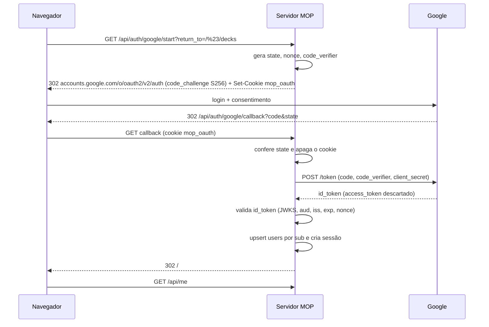

# 01 — Login com conta Google

> Depende de: [00-arquitetura.md](00-arquitetura.md) (ADR-01, ADR-03, tabelas `users`/`sessions`).

## 1. Objetivo

Permitir que o jogador entre com uma conta Google já existente, sem senha própria, para ter coleção, saldo e decks persistentes entre dispositivos, mantendo o modo convidado como está hoje.

**Fora do escopo:** login por e-mail/senha, outros provedores (GitHub, Discord) e 2FA próprio. A modelagem por `google_sub` permite criar depois uma tabela `identities` para outros provedores.

## 2. Histórias de usuário

- **US-1.1** Como visitante, clico em "Entrar com o Google", escolho minha conta e volto ao jogo logado, na mesma tela onde estava.
- **US-1.2** Como jogador novo, no primeiro login recebo um apelido sugerido (primeiro nome do Google), o kit inicial (ver [economia](02-economia.md)) e a oferta de importar os decks que já tenho neste navegador.
- **US-1.3** Como jogador, troco meu apelido e escolho se a foto do Google aparece para os outros.
- **US-1.4** Como jogador, saio da conta neste dispositivo ou em todos.
- **US-1.5** Como jogador, exporto ou excluo meus dados (LGPD).
- **US-1.6** Como convidado, continuo jogando contra a IA e em salas livres sem login.

## 3. Requisitos funcionais

| ID | Requisito |
|---|---|
| RF-1.1 | Fluxo OAuth 2.0 **Authorization Code + PKCE** no servidor (OIDC), com escopos `openid email profile`. Nenhum SDK do Google no front |
| RF-1.2 | O ID token é validado com `iss ∈ {https://accounts.google.com, accounts.google.com}`, `aud = GOOGLE_CLIENT_ID`, `exp`, `nonce` e assinatura via JWKS do Google (chaves em cache) |
| RF-1.3 | A conta é identificada por `sub`, nunca por e-mail. O e-mail só é guardado se `email_verified = true` |
| RF-1.4 | `state` e `nonce` aleatórios vão no cookie `mop_oauth` (HttpOnly, 10 min, assinado com `SESSION_SECRET`), junto com `code_verifier` e `return_to` |
| RF-1.5 | `return_to` só aceita caminhos relativos que começam com `/#/` (evita open redirect) |
| RF-1.6 | Depois do callback, cria a sessão (ADR-03), gira o id de sessão a cada login e redireciona para `return_to` |
| RF-1.7 | No primeiro login, uma única transação idempotente (chave `signup:`) cria `users` e as carteiras `PWC`/`CR` e aplica `signup_grant` e a coleção inicial |
| RF-1.8 | E-mail em `OWNER_EMAILS` com `email_verified` recebe `role = owner`, registrado no `audit_log` |
| RF-1.9 | Contas `suspended`/`banned` não criam sessão e veem "Conta suspensa até …" |
| RF-1.10 | O WS vincula a sessão ao usuário no `upgrade` (cookie), com no máximo 3 conexões WS simultâneas por conta |
| RF-1.11 | Importação de decks locais: o cliente envia `mop.decks.v1` e o servidor guarda tudo. Decks com cartas fora da coleção ficam marcados como "incompletos", e nenhuma carta é concedida por causa disso |
| RF-1.12 | Exclusão revoga as sessões e apaga a PII (`google_sub`, e-mail, avatar; nome vira "Jogador removido"), com `status = deleted`. Ledger e trocas continuam íntegros |

## 4. Fluxo

Biblioteca recomendada: `openid-client` v6 (discovery, PKCE e validação de ID token). Alternativa mínima: `jose` (`createRemoteJWKSet` + `jwtVerify`) com `fetch` para o endpoint de token.

## 5. API

| Método | Rota | Descrição |
|---|---|---|
| GET | `/api/auth/google/start?return_to=` | Inicia o fluxo (302) |
| GET | `/api/auth/google/callback` | Callback (302) |
| POST | `/api/auth/logout` | Encerra a sessão atual |
| POST | `/api/auth/logout-all` | Encerra todas as sessões do usuário |
| GET | `/api/me` | `{publicId, displayName, avatarUrl, role, balances:{PWC,CR}, features, csrfToken}` ou `401` |
| PATCH | `/api/me` | `{displayName?, showAvatar?}` |
| GET | `/api/me/export` | JSON com perfil, coleção, decks, ledger e trocas |
| DELETE | `/api/me` | Exclusão (confirmada digitando o apelido) |
| GET/PUT/DELETE | `/api/me/decks[/:id]` | Decks da conta (substituem o `localStorage` quando logado) |
| POST | `/api/me/decks/import` | Importação inicial (RF-1.11) |

## 6. Front-end

- **Novo store** `src/stores/account.js`:
  - estado `{ loaded, user, balances, features }`;
  - `loadMe()` chamado no boot (`src/main.js`);
  - `login(returnTo)` (navega para `/api/auth/google/start`) e `logout()`;
  - wrapper `api(method, path, body)` que injeta `X-CSRF-Token` e `Idempotency-Key`.
- **`App.vue`**: botão "Entrar com o Google" no topo. Depois do login vira avatar + saldo (PWC / CR) + menu (Perfil, Coleção, Loja, Trocas, Admin quando o papel permite, Sair).
- **Nova view** `src/views/ProfileView.vue` (`/#/perfil`): apelido, foto visível, sessões ativas, exportar e excluir.
- **`src/stores/decks.js`**: com `account.user`, `load/persist` usam `/api/me/decks`. Sem conta, continuam no `localStorage`. Depois do primeiro login aparece o modal "Importar N decks deste navegador?".
- **`src/net/client.js`**: envia `protocol: 2` quando logado, e o nome exibido vem da conta.
- O botão segue as diretrizes de marca do Google (logo "G" oficial, texto "Entrar com o Google").
- Flag `VITE_ACCOUNTS`: `1` no container, `0` no GitHub Pages.

## 7. Configuração no Google Cloud (operador)

1. Criar o projeto "Masters of Pwnage" e configurar a OAuth consent screen: External, nome do app, e-mail de suporte, logo e link da política de privacidade.
2. Em Credenciais, criar um OAuth Client ID do tipo *Web*:
   - Authorized JavaScript origins: `https://mop.cle.beer`
   - Authorized redirect URIs: `https://mop.cle.beer/api/auth/google/callback` e, para dev, `http://localhost:8787/api/auth/google/callback`
3. Em modo *Testing*, só os e-mails cadastrados como testadores conseguem logar. Para abrir, publicar o app (escopos básicos não exigem verificação).
4. Guardar `GOOGLE_CLIENT_ID`/`GOOGLE_CLIENT_SECRET` no Infisical e injetar via `deploy_mop.py`.

O site restrito a LAN+VPN não atrapalha: o redirect acontece no navegador do jogador, então o Google não precisa alcançar o servidor.

## 8. Critérios de aceite

- **CA-1.1** Dado um visitante em `/#/decks`, quando conclui o login Google, então volta para `/#/decks`, `GET /api/me` responde 200 e ele vê o saldo inicial.
- **CA-1.2** Dado um callback com `state` diferente do cookie, então a resposta é 400 e nenhuma sessão é criada.
- **CA-1.3** Dado um ID token com `aud` de outro client, então a resposta é 401 (teste com IdP falso).
- **CA-1.4** Dado `return_to=https://evil.example`, então o redirect final é `/#/`.
- **CA-1.5** Dado o mesmo `sub` logando duas vezes, então existe 1 usuário e 1 `signup_grant`.
- **CA-1.6** Dado um POST sem `X-CSRF-Token`, então a resposta é 403.
- **CA-1.7** Dado um usuário banido, então o callback mostra a página de conta suspensa e não cria sessão.
- **CA-1.8** Dado um convidado, então a prática contra IA e as salas livres funcionam como antes (os testes atuais de `server/test/` passam).
- **CA-1.9** Depois de `DELETE /api/me`, `GET /api/admin/users/:id` não mostra PII e o invariante I2 se mantém.

## 9. Tarefas

1. [ ] F0: Fastify + SQLite + runner de migrações + `001_core.sql` + envs novas em `config.js` + volume no Dockerfile/compose.
2. [ ] `server/src/auth/google.js` (start/callback) com `openid-client`.
3. [ ] `server/src/auth/session.js` (criar, ler, girar, revogar, CSRF) + middlewares `requireUser`/`requireRole`.
4. [ ] Vincular a sessão ao `upgrade` do WS (`server.js`) e aceitar o protocolo v2.
5. [ ] `/api/me*` + decks de conta + importação.
6. [ ] Front: `account.js`, header, `ProfileView`, integração com `decks.js` e `client.js`.
7. [ ] IdP falso para testes + CA-1.1…1.9.
8. [ ] Política de privacidade (`/#/privacidade`) e termos de uso.
9. [ ] `deploy_mop.py`: segredos, volume e backup.

## 10. Riscos

| Risco | Mitigação |
|---|---|
| Cookie de terceiros no build do GitHub Pages | ADR-03: contas só na origem do container |
| Conta Google comprometida leva ao roubo da coleção | Sessões visíveis no perfil, "sair de todos", trava de trocas em conta nova, reversão administrativa |
| Vazamento de foto/e-mail para outros jogadores | O lobby mostra só `displayName`. Foto é opt-in e o e-mail nunca é exposto |
| Admin logado num dispositivo perdido | Sessão admin de 12 h + step-up de 15 min (S4) |
