# 03 — Animações dos personagens (assets via Artlist MCP)

> Depende de: [00-arquitetura.md](00-arquitetura.md) (ADR-06, tabela `animations`, `card_catalog.animation_consent`) e [04-admin.md](04-admin.md) (fila e aprovação).

## 1. Objetivo

Dar vida aos ~165 personagens (criaturas, lendárias, planinautas, player cards) com animação **só na janela da arte**, sem deformar moldura, texto ou custo de mana, e gerar com o Artlist os novos assets visuais que a economia e o admin pedem.

Restrições do projeto:

- `cards/` e `images/` **nunca são editados**. Tudo que é gerado vai para `/data/media/anim/` (servidor) ou `public/` (build, ignorado no git).
- A maioria das cartas retrata **pessoas reais** da comunidade. Animar o rosto de alguém com IA exige **consentimento** (`animation_consent = 'concedido'`). Sem isso, a carta recebe só o nível CSS, que não altera o rosto.
- **Status (D5, 2026-10-31):** o dono do produto confirmou que as autorizações já existem. A semente do catálogo marca os personagens como `concedido`, e o opt-out continua no admin.

## 2. Orçamento (cotações reais do Artlist em 2026-10-31)

| Modelo (image-to-video, sem áudio) | Configuração | Custo por clipe |
|---|---|---|
| Kling v3 Standard 720p (variante com quadro final = inicial) | 5 s | **400 créditos** |
| Seedance 2.0 Fast 480p, modo quadro inicial/final | 4 s, 3:4 | 480 créditos |
| Omni 1.1 Interpolation 720p | 5 s | 750 créditos |
| Imagem estática (assets de UI), referência das gerações anteriores | 1 imagem | ~90 créditos |

Saldo atual: **12 060 créditos**. O plano AI Suite 16 500 renova em **19/11/2026**.

Estimativa para vídeo em todos os personagens: 165 × 400 × 1,4 (refações) ≈ **92 mil créditos**, o que dá cerca de 6 ciclos do plano. **Não cabe.** Por isso o sistema é em níveis:

| Nível | Quem recebe | Técnica | Custo Artlist |
|---|---|---|---|
| **N0 — Estático** | Cartas sem consentimento, não personagens, `reducedMotion` | Arte original | 0 |
| **N1 — Motion CSS** | Todos os personagens | Ken Burns sutil na janela da arte, *parallax* com o mouse/giroscópio, brilho holo pela raridade, partículas (faíscas neon) por "cor" de mana | 0 |
| **N2 — Loop em vídeo** | Raras, míticas e lendárias **com consentimento** | Loop sem emenda de 4–5 s gerado no Artlist a partir do recorte da arte | ~400–560 por carta aprovada |
| **N3 — Momento** (futuro) | Lendárias | Clipe único de "entrada em campo" (2–3 s) tocado quando a carta resolve | ~400 por carta |

Plano de ondas para o N2:

- **Piloto:** 3 cartas, incluindo a do CleBeer (consentimento implícito do dono), testando os 2 primeiros modelos da tabela. Escolhe-se 1 modelo e 1 template de prompt. Cerca de 2,6 mil créditos.
- **Onda 1:** lendárias e míticas com consentimento (estimativa de 10–15 cartas, ~8 mil créditos). Cabe no saldo atual.
- **Onda 2:** raras, depois da renovação de 19/11 (~16 mil créditos por ciclo).

O painel de admin mostra o custo acumulado por onda.

## 3. Pipeline (offline, operado no Claude Code com o MCP do Artlist)

```mermaid
flowchart LR
  A[images/*.webp<br/>somente leitura] --> B[scripts/anim/crop.mjs<br/>recorte da janela da arte]
  B --> C[folha de contato<br/>validação do recorte]
  C --> D[scripts/anim/queue.mjs<br/>fila JSON + prompts]
  D --> E[Claude Code + MCP Artlist<br/>upload_image → generate_video]
  E --> F[download_generation]
  F --> G[scripts/anim/encode.mjs<br/>ffmpeg → webm/mp4/poster]
  G --> H[scripts/anim/push.mjs<br/>POST /api/admin/animations]
  H --> I[Admin: revisão<br/>aprovar / rejeitar]
  I --> J[card_catalog.animation_id]
```



### 3.1 Recorte da arte (`scripts/anim/crop.mjs`)

- Lê de `images/` com `sharp` (já é devDependency) e escreve em `.anim-work/crops/<uid>.png` (ignorado no git e no docker).
- Retângulo padrão, medido na moldura de 1500×2100: `x 7 %, y 9.5 %, w 86 %, h 43.5 %` (≈ 1290×915 px, proporção ~1,41:1). Pode ser sobrescrito por carta em `scripts/anim/crops.json`, porque player cards e molduras antigas variam.
- Gera `.anim-work/contact-sheet.html` com todos os recortes para conferência visual antes de gastar créditos.

### 3.2 Fila e prompts (`scripts/anim/queue.mjs`)

- Seleciona cartas por `--tier`, `--rarity`, `--only-consented` (lê `GET /api/admin/catalog` com token de API) e escreve `.anim-work/queue.json` com `{uid, name, crop, prompt, model, settings}`.
- Template de prompt (inglês, que os modelos seguem melhor), preenchido com nome, tipo e uma frase-chave da descrição:

```
Subtle seamless idle loop of this illustrated trading-card character: {name}, {type_line}.
Keep the exact same face, identity, clothing, pose and art style. Camera locked, no cuts, no zoom.
Motion: slow breathing, natural blink, slight head turn, {flavor_motion}.
Background: soft neon cyberpunk light flicker, drifting particles.
No text, no new objects, no speech, no morphing. Last frame identical to first frame.
```

- `{flavor_motion}` vem de uma tabela por palavra-chave (por exemplo, "hacker"/"terminal" → "code glyphs reflecting on glasses"; "capivara" → "capybara companion breathing calmly"). A lista final é revisada pelo admin.

### 3.3 Geração (sessão do operador)

Para cada item da fila, a sessão do Claude Code:

1. `upload_image` do recorte;
2. `get_generation_cost` para confirmar o custo;
3. `generate_video` com o modelo escolhido no piloto, sem áudio, quadro final = inicial (loop);
4. ao concluir, `download_generation` para `.anim-work/raw/<uid>.mp4`.

O registro em `.anim-work/log.jsonl` guarda modelo (nome de exibição), prompt, custo e tentativas, que viram `animations.provenance`. É possível gerar até 4 cartas por chamada em lote, sempre dentro do teto de créditos da onda definido no admin.

### 3.4 Codificação (`scripts/anim/encode.mjs`, ffmpeg)

- Saídas:
  - `webm` (VP9, CRF 34) e `mp4` (H.264 baseline, CRF 26, `+faststart`), sem áudio, altura de 480 px, 24 fps, ≤ 5 s;
  - `poster.webp` (primeiro quadro).
- Meta: **≤ 700 KB por formato**. Acima de 1 MB a carta é rejeitada automaticamente.
- Loop sem emenda: se o modelo não fechar o loop, aplica crossfade de 0,4 s entre o fim e o início.

### 3.5 Envio e aprovação

- `push.mjs` faz `POST /api/admin/animations/:uid` (multipart, token com escopo `animations:write`) e cria `animations.status = 'revisao'`.
- O admin assiste ao vídeo sobre a moldura real, compara lado a lado com a arte original e aprova ou rejeita com motivo. Só `aprovada` entra no catálogo público.

## 4. Reprodução no jogo (front-end)

**Componente novo** `src/components/CardArtMotion.vue`, inserido em `CardTile.vue`:

- `<video muted loop playsinline preload="none" :poster>` posicionado em % sobre a janela da arte (`crop` vem do catálogo), com `object-fit: cover` e máscara de cantos arredondados igual à moldura.
- Política de reprodução:
  - **CardZoom** (`CardZoom.vue`): toca sempre que estiver aberto.
  - **Deck builder / loja / coleção**: toca no hover (desktop) ou ao tocar na carta (mobile). Usa `IntersectionObserver` e no máximo **3** vídeos ao mesmo tempo.
  - **Partida** (`GameView.vue`): ao entrar em campo (evento do engine), toca 1 loop e pausa no poster. Lendárias com N3 tocam o clipe de entrada. No máximo **2** simultâneos na mesa.
- O nível N1 é CSS puro numa classe `card-tile--motion` (keyframes de escala e translação em `transform`, sem *layout thrash*), mais partículas leves em `<canvas>` só no CardZoom.
- **Preferências** (`src/stores/settings.js`): nova opção "Animações das cartas" com os valores `sempre` | `ao ampliar` | `desligado`. O padrão é `ao ampliar` no celular e `sempre` no desktop. É forçada para `desligado` quando `settings.reducedMotion` ou `navigator.connection.saveData`.
- **Mídia** servida em `/media/anim/<uid>/<hash>.webm|mp4|webp`, com nome por hash do conteúdo e `Cache-Control: public, max-age=31536000, immutable`. Acrescentar `.webm`, `.mp4` e `.webp` ao `MIME` de `server/src/static.js`.

## 5. Novos assets estáticos (Artlist, geração de imagem)

Criar um **style kit "MOP Neon"** no Artlist com a paleta do jogo (tokens de `tailwind.config.js`: neon, cyan, amber, danger), guia de estilo cyberpunk/terminal e 3 referências (logo, playmat, hero de `src/assets/art/`). Todos os assets abaixo usam o kit.

| Asset | Uso | Qtde | Formato final |
|---|---|---|---|
| Ícone PwnCoin | saldo, loja, trocas | 1 + variante pequena | webp 256/64 |
| Ícone Crédito | saldo, preços | 1 + variante | webp 256/64 |
| Selos de raridade (5) | `CardTile`, filtros | 5 | webp/svg |
| Texturas holo por raridade | overlay CSS (`mix-blend-mode`) | 3 (rara, mítica, lendária) | webp 512 em tile |
| Fundo da loja | `ShopView` | 1 (+ versão tiny como os atuais `*-tiny.jpg`) | jpg |
| Fundo da coleção / carteira | views novas | 2 | jpg |
| Fundo do admin | `/admin` | 1 | jpg |
| Ilustração de "troca concluída" | modal de troca | 1 | webp |
| Molduras de avatar por temporada | perfil/lobby (ver 05) | 3 | webp |

Total: cerca de 20 imagens × ~90 créditos ≈ **1,8 mil créditos**. Os arquivos vão para `src/assets/art/` (são assets do produto, versionados) seguindo o padrão atual de `hero.jpg` + `hero-tiny.jpg`.

## 6. Requisitos não funcionais

- **RNF-3.1** O LCP da home e do deck builder não piora: vídeos com `preload="none"` e carregados só por interação.
- **RNF-3.2** Mesa com 2 vídeos ativos a ≥ 50 fps num celular médio (Moto G série recente). Se cair abaixo de 40 fps por 3 s, o jogo pausa os vídeos e passa para N1.
- **RNF-3.3** Total de mídia N2 ≤ 150 MB (≈ 100 cartas × 1,4 MB).
- **RNF-3.4** Acessibilidade: nada pisca acima de 3 Hz, que é a regra de fotossensibilidade. O prompt proíbe *strobe*.

## 7. Critérios de aceite

- **CA-3.1** Dada uma carta sem consentimento, então `GET /api/catalog` não traz animação N2 e só o N1 é aplicado.
- **CA-3.2** Dado o vídeo aprovado da carta X, quando abro o CardZoom, então o loop toca sobre a janela da arte e a moldura e o texto ficam idênticos à imagem original (comparação de pixels fora da janela, diferença ≤ 1 %).
- **CA-3.3** Dado `reducedMotion` ligado, então nenhum vídeo toca e nenhuma animação CSS de movimento roda.
- **CA-3.4** Dados 5 personagens com vídeo entrando em campo no mesmo turno, então no máximo 2 tocam ao mesmo tempo.
- **CA-3.5** Dado um upload acima de 1 MB ou com áudio, então o servidor rejeita com `422`.
- **CA-3.6** Dada uma onda com teto de 8 mil créditos, então a fila do pipeline para quando a soma das cotações atingir o teto.

## 8. Tarefas

1. [ ] Coletar consentimento: formulário simples (pode ser por e-mail/DM) e marcação no admin.
2. [ ] `crop.mjs` + `crops.json` + folha de contato.
3. [ ] Style kit "MOP Neon" + assets estáticos (§5).
4. [ ] Piloto N2 com 3 cartas e 2 modelos e decisão do template.
5. [ ] `queue.mjs`, `encode.mjs`, `push.mjs` + endpoint de upload + tabela `animations`.
6. [ ] `CardArtMotion.vue` + N1 em CSS + política de reprodução + preferências.
7. [ ] Onda 1 (lendárias/míticas com consentimento).
8. [ ] Onda 2 depois da renovação do plano.

## 9. Riscos

| Risco | Mitigação |
|---|---|
| Modelo altera o rosto (deriva de identidade) | Prompt de preservação, revisão humana obrigatória, rejeição com refação limitada a 2 por carta |
| Uso de imagem de pessoa real sem autorização | Consentimento explícito por carta, opt-out a qualquer momento (o admin arquiva a animação) |
| Custo descontrolado | Teto por onda, cotação antes de cada geração, preferência pelo modelo de 400 créditos |
| Peso no celular | `preload="none"`, limites de simultaneidade, fallback de fps |
| Direitos sobre o resultado gerado | Confirmar nos termos do plano Artlist o uso dos gerados num jogo público. Registrar a proveniência em `animations.provenance` |
